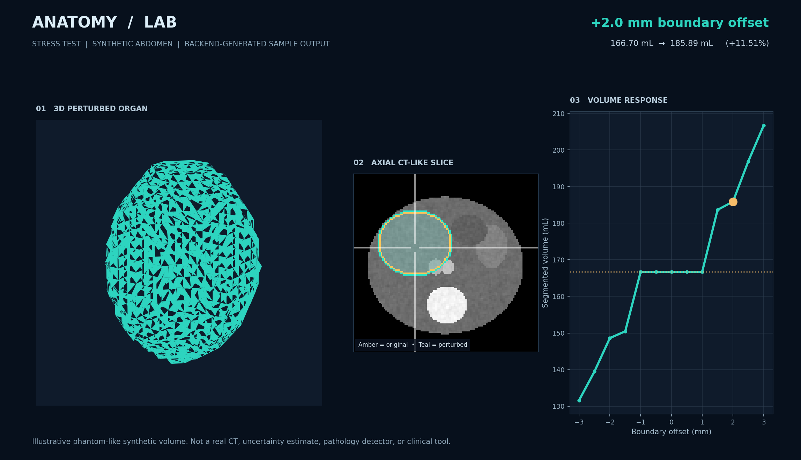

# Anatomy Stress Test

**A local, interactive CT-segmentation sensitivity lab.** Explore how small artificial boundary offsets alter voxel-based organ-volume measurements.

**What it does:** Renders a 3D organ mesh and synchronized axial/coronal/sagittal slices, lets you expand or erode a segmentation mask from **−3 to +3 mm** in 0.5 mm steps, computes volumes from the full-resolution binary mask, and displays an interactive volume-response curve with CSV export.

> **Important:** Built-in scans and masks are **synthetic, illustrative data**, not patient imaging or anatomical ground truth. This is a teaching and reproducibility prototype, **not** a medical device, validated uncertainty model, pathology detector, or new segmentation algorithm.

## Quick start (macOS / Linux)

Requires Python 3.11+ and a working internet connection for **first-time package installation**. The app itself requires no internet connection and loads a bundled copy of Plotly.

```bash
unzip Anatomy_Stress_Test.zip
cd Anatomy_Stress_Test
python3 -m venv .venv
source .venv/bin/activate
python -m pip install -r requirements.txt
python server.py
```

Open **http://127.0.0.1:8000**. You can also launch `./run_mac_linux.sh`.

Windows (PowerShell):

```powershell
py -3 -m venv .venv
.\.venv\Scripts\Activate.ps1
python -m pip install -r requirements.txt
python server.py
```

Or double-click `run_windows.bat`. Stop the server with **Ctrl+C**. Python must be installed with PATH support.

## Try the experiment

1. Click **Liver** in the left-hand panel.
2. Slide **Boundary displacement** from 0 to **+2.0 mm**. Notice the edited 3D boundary, changes to volume in milliliters and percentage, and the new position on the curve.
3. Try **−2.0 mm**; volume should decrease.
4. Click within any 2D slice to move the synchronized crosshair, **scroll the mouse wheel over an axial/coronal/sagittal slice to move one slice at a time**, hold **Shift** for five-slice jumps, or use the slice sliders. Focus a slice panel and use arrow keys for keyboard navigation. Rotate and zoom the 3D model with the mouse.
5. Click **Export results (CSV)** to download the complete offset/volume series.

## Customize in Codex (recommended)

You **do not need to paste the full source code** into Codex. Open Terminal in this extracted project folder and run:

```bash
cd /path/to/Anatomy_Stress_Test
codex
```

Codex can read and edit the source files already present in the working directory. Paste the task from `CODEX_START_HERE.md`, or tell Codex the specific update you want. The included `AGENTS.md` describes the project, its critical scientific constraints, and how to verify changes. Run `python -m pytest -q` after every change.

The four original palette hex values are at the very top of **`static/styles.css`**:

| Role | Hex |
| --- | --- |
| Cobalt accent | `#2F2FE4` |
| Deep blue | `#162E93` |
| Indigo panel | `#1A1953` |
| Midnight background | `#080616` |

Additional lighter tones are intentionally used for contrast and to distinguish the original versus perturbed masks. The theme does not alter numerical results.

## Upload your own CT and segmentation

Use **Use your own CT and segmentation** in the browser:

1. Select a CT `.nii`, `.nii.gz`, self-contained `.nrrd`, DICOM ZIP, or DICOM folder/files.
2. Select one or more segmentation masks (`.nii`, `.nii.gz`, `.nrrd`, or Slicer `.seg.nrrd`). Zero is background; positive integer labels become separate structures. Slicer segment names and overlapping layers are supported.
3. Click **Load CT and masks**. If multiple DICOM series are found, select a series and click Load again.
4. Select an organ in the sidebar and inspect its overlay. Enter a descriptive name in **Selected organ label** (included in exported settings).
5. Adjust boundary displacement. **Download mask + results + settings** produces a ZIP with the current full-grid `segmentation.nii.gz`, all offset measurements in `measurements.csv`, and `settings.json` with the label, affine, spacing, selected offset, method, and metrics. The existing CSV button remains available.

Imports preserve physical geometry and reject mismatches; there is no silent interpolation. Cropped Slicer masks are accepted if they lie exactly on the CT grid. DICOM support covers regular single-frame CT series; enhanced multiframe, irregular spacing, duplicates, and gantry tilt require conversion/resampling in Slicer first. Slice painting and erasing are supported; automatic segmentation is not implemented.

Files are processed locally. Temporary uploads are deleted after import; loaded arrays remain in server memory until replacement or restart. Each browser cookie session has its own dataset (tabs in the same browser share it). This is a single-process local app, limited to four loaded sessions, 1 GiB of uploaded files, 100 million voxels per volume, and 500 million aggregate mask voxels. Restarting clears imported sessions. ZIPs must also expand to at most 1 GiB and 10,000 files. Detached NRRD files are unsupported. Real-world vendor DICOM variants may require conversion in Slicer.


## Real NIfTI scans (optional)

**Only use scans you have permission to process.** Never commit clinical images, names, IDs, accession numbers, or identifying screenshots to a public repository.

The expected folder layout mirrors the supplied TotalSegmentator CT Explorer guide:

```
/path/to/my_subject/
  ct.nii.gz
  segmentations/
    liver.nii.gz
    spleen.nii.gz
    kidney_left.nii.gz
    ...
```

In Terminal, set the environment variable before starting the app:

```bash
export ANATOMY_DATASET_DIR="/absolute/path/to/my_subject"
python server.py
```

Windows PowerShell:

```powershell
$env:ANATOMY_DATASET_DIR="C:\path\to\my_subject"
python server.py
```

For Windows `cmd.exe`: `set ANATOMY_DATASET_DIR=C:\path\to\my_subject`.

The loader uses **nibabel**, converts each image to closest canonical **RAS+** orientation, checks mask and CT shape and affine alignment, and refuses mismatches instead of silently resampling. Measurements use the original grid; 3D display meshes may be downsampled. Expect higher memory usage for full-resolution CT; large masks can be slow. The app is designed for small local research demonstration datasets, not clinical service.

If an imported segmentation reaches the first or last voxel along any axis, the UI warns that its observed volume may be truncated by the field of view.

## How the experiment works

For a binary mask `M` and physical voxel spacing `(sx,sy,sz)`:

- **Baseline volume (mL)** = `voxel_count(M) × sx × sy × sz / 1000`.
- **Positive offset (+d mm):** keep every positive voxel and include background voxel centers within Euclidean distance `d` of a positive voxel.
- **Negative offset (−d mm):** keep only positive voxel centers with distance greater than `d` from a background voxel.
- **Relative change** = `100 × (perturbed volume / baseline volume − 1)`.

The distance transform is computed using `scipy.ndimage.distance_transform_edt` and physical spacing. This voxel-center method creates a **staircase response**, especially when the offset is smaller than the voxel spacing. It is **not** a continuous subvoxel surface displacement, a validated measure of segmentation uncertainty, or a simulation of biologically plausible contour errors. The CT intensities themselves never change.

If the acquisition is markedly anisotropic, the steps will be more noticeable. Oblique acquisitions are handled for geometric display coordinates via the affine, but NIfTI masks must be on the same grid as CT.

## Tests

```bash
python -m pip install -r requirements-dev.txt
python -m pytest -q
```

Tests check that zero offset is an exact identity, volumes change monotonically with offset, physical voxel units are correct, original anatomical viewing orientation is preserved, and the HTTP endpoints return meshes and PNG slices. GitHub Actions runs these checks after each push.

## Repository layout

```
server.py                 FastAPI routes and caching
anatomy_lab/dataset.py    Synthetic demo and optional NIfTI loading
anatomy_lab/geometry.py   Euclidean distance transforms, volume, mesh
anatomy_lab/imaging.py    Radiological slice orientation, PNG overlays
static/index.html         Viewer interface
static/styles.css         Styling and responsive layout
static/app.js             Interactive controls, Plotly graphs, exports
static/plotly.min.js      Locally bundled open-source Plotly JS
Tests/                     (tests/) automated checks
LINKEDIN_POST.md          Accurate, ready-to-customize announcement
```

## Publish to GitHub

After running the tests and checking the demo:

```bash
git init
git add .
git commit -m "Build Anatomy Stress Test educational CT geometry lab"
git branch -M main
git remote add origin https://github.com/YOUR_USERNAME/anatomy-stress-test.git
git push -u origin main
```

Create the empty repository on GitHub first. Or, if you use the official GitHub CLI, run `gh repo create anatomy-stress-test --public --source=. --push` after initializing and committing.

`data/` and common medical image extensions are excluded in `.gitignore`, but **review `git status` before every push**. Uploaded images can carry identifying information; use only the bundled synthetic demo for public screenshots unless you have verified authorization.

Plotly's bundled JavaScript is redistributed under its own MIT license. For source information see: https://github.com/plotly/plotly.js .

## Project origins and attribution

Inspired by the user-provided *Build a 3D CT scan explorer with one prompt* guide by @hinnazeejah. This application is a new **FastAPI + Plotly** implementation, rather than a modification of the guide's Next.js/React source. It reuses the concept of 3D meshes and three orthogonal views, but adds a measurement-focused, physically parameterized segmentation perturbation experiment.

For clinical CT masks, follow the data provider's licensing and attribution requirements (e.g., TotalSegmentator: Wasserthal et al., https://zenodo.org/records/10047292). No TotalSegmentator scans are distributed in this repository.

## Scope and limitations

- No segmentation algorithm is trained or developed; the app takes existing binary masks as inputs.
- Expanding/eroding a binary mask does not represent the distribution of real segmentation errors.
- Surface meshes are **visualizations** and must not be used to calculate reported volumes.
- Volume assumes provided image and masks are aligned, with correct physical units.
- This is not a diagnostic, treatment-planning, or clinical decision support tool.
- The functionality may have precedents in existing medical-image morphology and QA systems; originality claims require a comprehensive literature/prior-art review.

MIT-licensed source code. Contributions and pull requests welcome.

## Example output



The figure is generated from the same backend functions as the app; it is **not a screenshot of the web interface**. The +2 mm example is a synthetic shape whose original segmented volume is approximately 166.70 mL. Your actual output depends on the selected mask and voxel spacing.

## Anatomical fragility map

Select an organ, choose a displacement (0.5–3 mm), and click **Build map + compare organs**.

The regional map partitions the original mask into 10 mm grid cells along canonical voxel axes, anchored at CT voxel index zero. Each cell reports `100 × removed baseline voxels / baseline voxels` after inward erosion. Measurements use original-resolution voxels; surface colors interpolate regional percentages between mesh vertices on a fixed 0–100% scale. Regions with fewer than 50 baseline voxels are flagged; larger regions appear first in the top-20 table. This cutoff is a display heuristic, not a confidence threshold.

The organ comparison reports inward loss and outward gain relative to baseline. Ranking uses the volume span `100 × (expanded volume − eroded volume) / baseline volume` at equal displacement. Invalid masks are reported individually.

**Download map and measurements** exports `regional_loss_pct.nii.gz` (original CT grid and affine, percent values inside the mask, NaN outside), all regions in `regions.csv`, the organ comparison in `organs.json`, and calculation settings in `settings.json`.

This measures segmentation sensitivity, not tissue weakness, disease risk, mechanical stress, or calibrated uncertainty. Results depend on grid placement, cell size, voxel spacing, and field-of-view clipping. The map evaluates uniform inward erosion, not independent localized contour errors, and uses mask geometry rather than CT intensity. Subvoxel offsets may produce zero change. Validation uses synthetic fixtures and checks voxel conservation, physical units, thin/thick structures, subvoxel behavior, exports, and ranking. Real-dataset and external-tool validation remain future work.

## Imaging workspace

The default view is a compact four-up workspace: axial and 3D above sagittal and coronal. Import, segment selection, boundary displacement, and display controls are in the collapsible left panel. Use the corner button to maximize a view and **Fit views** to restore the layout and 3D camera. Slice scrolling, keyboard navigation, and linked click positions remain available. Slice aspect ratios use physical voxel spacing.

**Display** provides soft-tissue, bone, and lung CT presets, numerical window level/width, and segmentation-overlay and crosshair toggles. **Fragility & analysis** opens the regional map, organ comparison, response curve, and exports. This is a Slicer-inspired viewing workflow; CT volume rendering is not included. The bundled data remains synthetic; upload real imaging to inspect real anatomy.

## Create and edit segments

After loading your CT and segmentation mask, the **Segments** list shows the imported labels. Select any label to edit it, or enter a name in **Selected organ label** and click **New empty**. **Duplicate** makes an independent copy of the selected mask. **Rename** saves the entered display name.

Choose **Paint** or **Erase**, set the brush radius in millimeters, and click or drag on an axial, sagittal, or coronal image. Release to apply the stroke. The brush operates on the displayed slice only, uses physical voxel spacing, and does not interpolate masks between slices. Use slice scrolling to continue on neighboring slices. Editing works on the baseline mask and resets boundary displacement to zero. Choose **Navigate** to resume linked crosshair selection and stress testing.

**Undo stroke** restores the most recent stroke for the selected segment (one-level undo, no redo). Creating or duplicating a segment clears this undo history. Measurements and the surface refresh after edits; existing fragility maps are invalidated. Empty segments can be viewed and painted but cannot produce a fragility map.

Edits remain in the current browser session's server memory and are lost on replacement/restart. **Download mask + results + settings** saves the selected edited mask and its analysis; it does not save all segments as one scene. Original uploaded files are never overwritten. Segment painting is a basic manual tool, not automated segmentation or a full Slicer Segment Editor.
